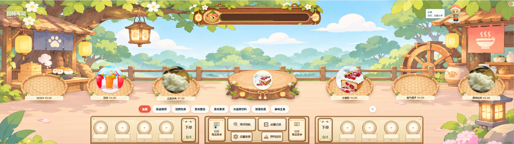

# Phase 02：林间点餐台视觉适配

## 仓库与主题映射

- 工作分支：`themev4`；实施前工作区无未提交修改，基线提交为 `6559692`。
- 本地有效实现中，林间主题为 `zhenxian`，资源目录为 `public/images/ui/b/`；云端主题为 `xiaoxin`，资源目录为 `public/images/ui/c/`。此映射与本阶段任务描述一致。
- 原有林间背景、进度条、竹编普通载具和树桩特殊载具保持原资源与运动逻辑。云端主题资源未改动。

## 修改文件

| 文件 | 内容 |
| --- | --- |
| `src/components/display/CartPanel.vue` | 林间专属左右木质购物台、陶瓷餐位、菜名与数量区域、木牌下单按钮及提示素材；保留动态文字、计数、菜品图片和原交互事件。 |
| `src/components/display/CenterFunctionPanel.vue` | 林间专属一体式中央木台、菜单木牌、四个统一风格功能按钮及图标；保留原按钮位置和事件。 |
| `src/views/customer/MenuView.vue` | 林间主题在常见桌面宽度下将商品菜单居中，避免关闭按钮跑出屏幕。 |
| `src/views/display/ConveyorBeltDisplay.vue` | 林间进度牌在 769–1920px 视口内收窄，避免遮住右上角助手；3840px 设计宽度不变。 |

## 新增素材

均为透明或局部透明 SVG，位于 `public/images/ui/b/`：

- 台体：`forest-cart-base.svg`、`forest-center-base.svg`
- 餐位与下单牌：`forest-place-setting.svg`、`forest-order-sign.svg`
- 菜单与功能按钮：`forest-menu-sign.svg`、`forest-action-button.svg`
- 功能图标：`forest-icon-navigation.svg`、`forest-icon-record.svg`、`forest-icon-settings.svg`、`forest-icon-waiter.svg`
- 提示牌：`forest-tip-order.svg`、`forest-tip-limit.svg`

木质外观由可复用的矢量素材承担；CSS 主要负责素材定位、尺寸、文字、状态和响应式适配。菜名、数量、`下单`文字与 `0/4` 等计数仍由真实 DOM 和原业务数据渲染。

## 实际页面截图

在本地真实 `/display` 页面以 3840×1080 视口查看林间主题；下图裁去了浏览器界面，只保留页面画面。

## 验证结果

| 场景 | 结果 |
| --- | --- |
| 林间空购物车 | 3840×1080 与 1280px 桌面宽度下，左右餐位、下单牌和中央木台正常显示。 |
| 已选菜品、接近满额及满额 | 左侧加至 4/4，右侧由 1/4 经数量加键加至 4/4；图片、菜名、计数和满额提示正常，满额时加键禁用。 |
| 增减与删除 | 右侧从 4/4 减至 3/4，再删除至 0/4；左侧测试菜品全部删除后恢复 0/4。 |
| 菜单与中央功能 | 左右商品菜单可打开；1280px 下菜单完整位于视口内且可关闭。寿司导航、点餐记录、设置弹窗和呼叫店员确认弹窗均可打开。 |
| 下单按钮状态 | `0/4`、`1/4`、`4/4` 随购物车实时变化；满额和待下单状态对应木牌文字颜色变化。 |
| 云端主题 | 切换至 `xiaoxin` 后确认购物车、中央台与菜单按钮仍使用 `/images/ui/c/` 原素材，页面视觉与功能保持原样；再切回林间主题正常。 |
| 静态验证 | 12 个 SVG 均通过 XML 解析；`git diff --check` 通过；`npm run build` 成功。构建仅有项目原有的 Sass 弃用和大包体积提示。 |

## 遗留问题

- 未实际提交测试订单或确认呼叫店员，以免向真实业务流程写入测试数据；提交中与完成后的服务端反馈尚需在可清理的测试环境复核。
- 现有商品菜单内部仍沿用原组件视觉；本阶段仅调整其林间主题下的桌面位置，菜单内容换肤不在本次底部点餐台范围内。
